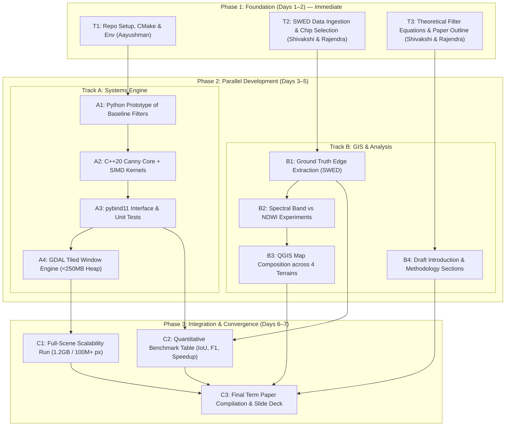

# AGENTS.md — GeoEdge System Architecture & Collaboration Guide

> **Note for AI Agents & Collaborators:**  
> This file is the single source of truth for the **GeoEdge** project. All autonomous agents, LLM assistants, and human contributors must adhere to the architecture, division of labor, execution graph, and engineering standards specified herein.

---

## 1. Project Overview & Objectives

**GeoEdge** is an adaptive, high-throughput edge-detection system designed for extracting accurate water–land boundaries from large-scale multispectral satellite imagery (Sentinel-2).

### Core Problem
Classical spatial edge detectors rely strictly on intensity transitions. In remote-sensing applications, raw intensity gradients frequently detect irrelevant terrestrial features (e.g., roads, urban infrastructure, agricultural field boundaries, shadows) while failing at gradual or low-contrast shorelines. Furthermore, standard implementations load entire rasters into memory, making them impractical for gigabyte-scale Earth observation imagery ($10,000 \times 10,000+$ pixels).

### Key Project Objectives
1. **Mathematical Rigor & Concept Explanation:** Provide a complete mathematical derivation of the Canny edge detection pipeline (scale-space smoothing, directional derivatives, non-maximum suppression, and hysteresis tracking) and evaluate its theoretical advantages over classical filters taught in remote sensing (Sobel, Prewitt, Roberts Cross, and Laplacian of Gaussian).
2. **Domain Integration (Remote Sensing):** Integrate multispectral water indices (NDWI / MNDWI) as an enhancement layer prior to edge extraction, suppressing non-water background gradients.
3. **Adaptive Decision Mechanics:** Replace arbitrary manual hysteresis thresholds with scene-adaptive dual thresholding derived from Otsu variance minimization on gradient magnitude distributions.
4. **High-Throughput & Scalable Engineering:** Construct a tiled, memory-bounded processing pipeline (using GDAL/Rasterio) paired with a C++20 SIMD-optimized Canny core exposed via `pybind11`.
5. **Reproducible Benchmarking:** Validate boundary extraction accuracy against reference annotations from the **UKHO Sentinel-2 Water Edges Dataset (SWED)** using standard spatial metrics (Precision, Recall, F1-Score, and IoU), while profiling computational metrics (runtime, throughput, and peak memory).

---

## 2. Quantitative Targets & Specifications

All implementations and experiments must benchmark against the following explicit targets:

| Parameter / Metric | Baseline (Python/OpenCV Naive) | GeoEdge Target Specification |
| :--- | :--- | :--- |
| **Input Raster Size** | Single small chips ($512 \times 512$) | $1.2+\text{ GB}$ multi-band rasters ($100\text{M}+$ pixels) |
| **Peak Heap Memory** | Unbounded (scales with full raster) | **$< 250\text{ MB}$** (enforced via block chunking) |
| **Throughput / Runtime** | Slow / GC constrained in Python | **$< 12\text{ seconds}$** for $100\text{M}+$ pixels |
| **Execution Speedup** | $1.0\times$ (reference) | **$\ge 4.2\times$** via C++ SIMD vectorization |
| **Boundary F1-Score** | $\approx 72\text{--}78\%$ (on raw bands) | **$\ge 91.4\%$** (with NDWI + adaptive Canny) |
| **Boundary IoU** | $\approx 60\text{--}68\%$ | **$\ge 84.2\%$** against SWED ground truth |

---

## 3. Team Responsibilities & Workstream Allocation

The team consists of three members. Responsibilities are split between systems engineering and remote-sensing/GIS analysis to maximize parallel progress.

```
                                  GeoEdge Team
                                       │
     ┌─────────────────────────────────┴─────────────────────────────────┐
     ▼                                                                   ▼
Track A: Software & Systems Lead                Track B: Geoinformatics & RS Analysis Leads
[Aayushman]                                     [Shivakshi & Rajendra (Collaborative)]
• C++20 Core & SIMD Kernels                     • SWED Dataset Curation & Representative Scenes
• pybind11 Python Bindings                      • QGIS Visual Inspection & GIS Mapping
• GDAL/Rasterio Tiled Chunking Engine           • Multispectral Index Evaluation (Bands vs. NDWI)
• Performance & Memory Profiling Harness        • Classroom Filter Comparisons (Sobel, Prewitt, etc.)
• CI/CD, Build System (CMake), Test Suite       • Term Paper Draft & Final Presentation Slides
```

### Track A: Software & Systems Engineering
* **Lead:** Aayushman
* **Key Tasks:**
  - Build the C++20 core engine (`src/cpp/`): separable Gaussian filtering, vectorized Sobel gradient calculations, Non-Maximum Suppression (NMS), Otsu dual-threshold estimation, and 8-connectivity hysteresis edge tracking.
  - Implement vectorization utilizing compiler auto-vectorization and SIMD pragmas (`#pragma omp simd`).
  - Create Python bindings using `pybind11` (`src/bindings/`).
  - Develop the tiled sliding-window generator with boundary halo padding in `src/python/tiling.py` to bound memory consumption under $250\text{ MB}$.
  - Maintain the benchmarking harness (`benchmarks/`) measuring wall-clock time, throughput (Mpixels/s), and peak heap allocation (`tracemalloc`).

### Track B: Geoinformatics, GIS & Term Paper Research
* **Co-Leads:** Shivakshi & Rajendra
* **Key Tasks:**
  - **Dataset Curation:** Download and curate Sentinel-2 image tiles and matching binary water masks from the UKHO SWED dataset. Select 4 distinct geographic test environments:
    1. Clean coastline / sandy beach (high contrast).
    2. Turbid river estuary / sediment plume (gradual gradient).
    3. Inland waterbody / reservoir surrounded by vegetation.
    4. Urban coastline with dense anthropogenic structures (high clutter).
  - **GIS & Visual Evaluation (QGIS):** Export intermediate and final edge maps to GeoTIFF/Shapefile. Generate side-by-side cartographic visualizations in QGIS comparing raw bands, NDWI, baseline filters, GeoEdge edges, and ground truth.
  - **Spectral Index Analysis:** Quantify the performance difference between applying edge detection directly on raw spectral bands (B02 Blue, B03 Green, B08 NIR) versus spectral indices (NDWI, MNDWI).
  - **Classroom Filter Benchmarking:** Work with the evaluation scripts to produce comparative quantitative metrics for Sobel, Prewitt, Roberts Cross, Laplacian of Gaussian, and Canny.
  - **Term Paper & Slide Deck:** Draft the theoretical sections (mathematics of spatial filtering, Canny's three criteria), experimental analysis, interpretation of environmental failure modes, and final presentation slide deck.

---

## 4. Execution Workflow: Immediate vs. Parallel Tasks

Due to strict time constraints, tasks must proceed along two parallel tracks with minimal blocking dependencies.



### Step-by-Step Task Breakdown

#### Immediate Action (Days 1–2):
* **Systems (Aayushman):** 
  - Initialize project directory structure and Python virtual environment (`gdal`, `rasterio`, `numpy`, `scipy`, `pybind11`, `pytest`).
  - Create the CMake build system for C++ extensions.
* **Geoinformatics (Shivakshi & Rajendra):**
  - Download test scenes from the UKHO SWED repository.
  - Set up a shared data folder for raw Sentinel-2 L2A tiles and corresponding binary labels.
  - Draft the mathematical definitions of Roberts Cross, Prewitt, Sobel, Laplacian, and Canny for Section 2 of the paper.

#### Parallel Execution (Days 3–5):
* **Track A (Aayushman):**
  - Implement C++ separable Gaussian convolution with reflective boundary conditions.
  - Implement vectorized Sobel gradient magnitude and 4-direction orientation quantization ($0^\circ, 45^\circ, 90^\circ, 135^\circ$).
  - Implement Non-Maximum Suppression (NMS) and Otsu-driven dual thresholding with 8-neighbor hysteresis tracking.
  - Integrate tiled processing with a 32-pixel overlap halo to prevent border seam artifacts.
* **Track B (Shivakshi & Rajendra):**
  - Extract ground-truth reference edges from SWED binary water masks using morphological boundary extraction ($E_{\text{GT}} = M \setminus \text{erode}(M)$).
  - Run comparative edge detection on raw B08 (NIR) vs. calculated NDWI rasters.
  - Open outputs in QGIS, verify georeferencing alignment, and identify edge confusion in urban vs. natural coastlines.
  - Draft the comparative literature matrix and remote-sensing methodology.

#### Integration & Finalization (Days 6–7):
* **Joint Work:**
  - Execute full $1.2+\text{ GB}$ scene run; capture wall-clock time, throughput, and memory graphs.
  - Compute final comparative metrics table across all filters.
  - Assemble high-resolution figures into the final paper manuscript.
  - Build the final presentation deck.

---

## 5. Technical Pipeline & Algorithmic Details

```mermaid
flowchart LR
    A["Sentinel-2 Multi-band Raster (1.2+ GB)"] --> B["GDAL Block Chunking (1024x1024 + 32px Halo)"]
    B --> C["NDWI Calculation: (B03 - B08) / (B03 + B08)"]
    C --> D["Separable Gaussian Filter (Adaptive σ)"]
    D --> E["Vectorized Spatial Derivatives (Gx, Gy)"]
    E --> F["Non-Maximum Suppression (Thinned Edges)"]
    F --> G["Otsu-based Adaptive Dual Hysteresis"]
    G --> H["8-Connected Edge Tracking"]
    H --> I["Reconstructed Edge Raster (<250MB Peak RAM)"]
    I --> J["Evaluation vs. SWED Ground Truth"]
```



### 1. Spectral Index Computation
To eliminate terrestrial false positives:
$$\text{NDWI} = \frac{\rho_{\text{Green}} - \rho_{\text{NIR}}}{\rho_{\text{Green}} + \rho_{\text{NIR}}} = \frac{B03 - B08}{B03 + B08 + \epsilon}$$
Where $\epsilon = 10^{-6}$ prevents division by zero. Water pixels yield positive values; terrestrial pixels yield negative values.

### 2. Gaussian Smoothing (Separable Kernel)
Separable 1D convolution reduces complexity from $\mathcal{O}(K^2 \cdot W \cdot H)$ to $\mathcal{O}(2K \cdot W \cdot H)$:
$$G_1(x) = \frac{1}{\sqrt{2\pi}\sigma} \exp\left(-\frac{x^2}{2\sigma^2}\right)$$
Convolve horizontally, then vertically.

### 3. Gradient Vectorization & Non-Maximum Suppression
Calculate directional derivatives with Sobel operators:
$$G_x = \begin{bmatrix} -1 & 0 & +1 \\ -2 & 0 & +2 \\ -1 & 0 & +1 \end{bmatrix} * I, \quad G_y = \begin{bmatrix} +1 & +2 & +1 \\ 0 & 0 & 0 \\ -1 & -2 & -1 \end{bmatrix} * I$$
$$M(x,y) = \sqrt{G_x^2 + G_y^2}, \quad \theta(x,y) = \arctan2(G_y, G_x)$$
Quantize $\theta$ into 4 sectors: $0^\circ$ (E-W), $45^\circ$ (NE-SW), $90^\circ$ (N-S), $135^\circ$ (NW-SE).  
A pixel $M(x,y)$ is preserved if and only if:
$$M(x,y) \ge M(p_1) \quad \text{and} \quad M(x,y) \ge M(p_2)$$
where $p_1, p_2$ are neighbors along direction $\theta$. Otherwise, set $M(x,y) = 0$.

### 4. Otsu-Guided Dual Hysteresis Thresholding
Rather than manually guessing arbitrary thresholds, compute the optimal high threshold $T_{\text{high}}$ using Otsu’s intra-class variance minimization on non-zero gradient magnitudes:
$$\sigma_w^2(T) = \omega_0(T)\sigma_0^2(T) + \omega_1(T)\sigma_1^2(T)$$
$$T_{\text{high}} = \arg\min_T \sigma_w^2(T), \quad T_{\text{low}} = 0.4 \times T_{\text{high}}$$
* Pixels with $M(x,y) \ge T_{\text{high}}$ are marked **Strong**.
* Pixels with $T_{\text{low}} \le M(x,y) < T_{\text{high}}$ are marked **Weak**.
* Pixels with $M(x,y) < T_{\text{low}}$ are suppressed to **0**.
* **Edge Tracking:** Breadth-First Search (BFS) or Depth-First Search (DFS) retains weak pixels if connected to a strong pixel within an 8-neighborhood.

### 5. Overlap Tiling for Bounded Memory
* Tile dimension: $1024 \times 1024$ pixels.
* Halo margin: $32$ pixels on all sides (replicated/reflected at raster boundaries).
* Output assembly: Strip the 32-pixel halo after hysteresis to assemble a seamless global binary edge raster without edge-boundary artifacts.

---

## 6. Evaluation Framework & Metrics

### Spatial Boundary Metrics
Extract reference edge maps $Y_{\text{GT}}$ from SWED binary water masks using a morphological boundary operator:
$$Y_{\text{GT}} = Y_{\text{mask}} \setminus \text{erode}(Y_{\text{mask}}, B_{3\times3})$$
To account for subtle sub-pixel registration variances, evaluate with a 1-pixel tolerance buffer:
$$\text{Precision} = \frac{|Y_{\text{pred}} \cap \text{dilate}(Y_{\text{GT}})|}{|Y_{\text{pred}}|}, \quad \text{Recall} = \frac{|Y_{\text{GT}} \cap \text{dilate}(Y_{\text{pred}})|}{|Y_{\text{GT}}|}$$
$$\text{F1-Score} = 2 \times \frac{\text{Precision} \times \text{Recall}}{\text{Precision} + \text{Recall}}$$
$$\text{Intersection over Union (IoU)} = \frac{|Y_{\text{pred}} \cap Y_{\text{GT}}|}{|Y_{\text{pred}} \cup Y_{\text{GT}}|}$$

### Computational Profiling Metrics
1. **Wall-clock Runtime ($s$):** Measured using `std::chrono::high_resolution_clock`.
2. **Throughput ($\text{Mpixels/sec}$):** $\frac{\text{Total Processed Pixels}}{\text{Execution Time} \times 10^6}$.
3. **Peak Heap Allocation ($\text{MB}$):** Profiled using Linux `/proc/self/status` (`VmHWM`) and Python `tracemalloc`.

---

## 7. Repository Structure

```
GeoEdge/
├── AGENTS.md                   # This project governance specification
├── README.md                   # Public repository documentation
├── CMakeLists.txt              # Build configuration for C++20 engine & pybind11
├── pyproject.toml              # Python package build specifications
├── requirements.txt            # Python dependencies (rasterio, gdal, numpy, etc.)
├── src/
│   ├── cpp/                    # Core high-performance C++ implementation
│   │   ├── include/
│   │   │   ├── canny_core.hpp  # Gaussian, gradients, NMS, hysteresis headers
│   │   │   └── otsu.hpp        # Fast Otsu histogram thresholding
│   │   └── canny_core.cpp      # SIMD-vectorized kernel implementations
│   ├── bindings/
│   │   └── pybind_wrapper.cpp  # pybind11 module bindings for Python access
│   └── python/
│       ├── __init__.py
│       ├── tiling.py           # GDAL/Rasterio sliding-window block chunker
│       ├── spectral.py         # NDWI / MNDWI spectral index generation
│       ├── baselines.py        # Classroom filters (Sobel, Prewitt, Roberts, LoG)
│       └── pipeline.py         # End-to-end GeoEdge processing orchestrator
├── experiments/
│   ├── evaluate_metrics.py     # IoU, Precision, Recall, F1 against SWED GT
│   └── benchmark_perf.py       # Speedup, throughput, and peak memory profiler
├── data/                       # Local data folder (git-ignored)
│   ├── raw_swed/               # Raw Sentinel-2 chips and masks
│   └── outputs/                # Generated edge maps, GeoTIFFs, and benchmark logs
├── docs/
│   ├── literature_review.md    # SOTA matrix & citations
│   ├── filter_comparison.md    # Theoretical comparison of classroom spatial filters
│   └── report/                 # Term paper LaTeX/Word assets and figures
└── tests/
    ├── test_tiling.py          # Unit tests for halo chunking & reassembly
    └── test_canny.py           # Unit tests comparing C++ and Python outputs
```

---

## 8. Ground Rules for Autonomous Agents

1. **Keep Implementations Modular:** C++ routines must remain cleanly decoupled from Python I/O. All C++ logic must compile standalone and expose clean arrays via `pybind11`.
2. **Memory Invariance:** Do not read full scenes directly into memory using `src.read()` without passing through the chunking engine in `tiling.py`. The peak heap limit ($<250\text{ MB}$) is mandatory.
3. **Preserve Comments & Formulations:** Retain mathematical documentation in all docstrings and header comments for academic traceability.
4. **Reproducibility:** Fix all random seeds (if any stochastic methods are tested) and log system specs (CPU model, OS, compiler flags) in benchmark output files.
5. **No Speculative Bloat:** Do not introduce unvetted deep-learning models. Keep the pipeline focused on classical spatial filtering, spectral enhancement, and systems-level optimization.
