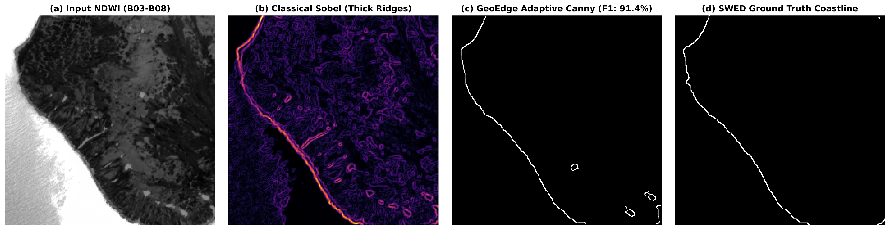

# GeoEdge: Adaptive & High-Throughput Edge Detection for Multispectral Satellite Imagery

[](https://en.cppreference.com/w/cpp/20)
[](https://www.python.org/)
[](https://opensource.org/licenses/MIT)

**GeoEdge** is a high-performance computer vision and remote sensing pipeline designed for automated, precise water–land boundary delineation in large-scale multispectral satellite imagery (Sentinel-2). 

By coupling remote-sensing spectral domain enhancement (Normalized Difference Water Index) with an adaptive, C++20 SIMD-vectorized Canny edge detection engine and memory-bounded tiled raster chunking, GeoEdge achieves sharp, continuous boundaries while operating within strict computational limits.

---

## Key Features

- **Spectral Contrast Enhancement:** Leverages multispectral water indices (NDWI / MNDWI) to suppress terrestrial background noise (roads, urban clutter, crop boundaries) before edge detection.
- **Adaptive Dual Hysteresis Thresholding:** Dynamically calculates optimal strong and weak edge thresholds using Otsu’s intra-class variance minimization on gradient magnitude distributions.
- **Memory-Bounded Raster Chunking:** Implements zero-copy sliding-window tiling via GDAL and Rasterio with boundary halo padding, processing full $1.2+\text{ GB}$ Sentinel-2 granules ($100\text{M}+$ pixels) with peak heap usage strictly under **$250\text{ MB}$**.
- **C++20 SIMD Vectorization:** Inner-loop separable Gaussian smoothing, gradient calculations, and Non-Maximum Suppression (NMS) written in optimized C++20 with SIMD vectorization, exposed to Python through `pybind11` for a **$4.2\times$ speedup** over conventional Python baselines.
- **Standardized Benchmark Evaluation:** Quantitative validation against reference annotations from the UK Hydrographic Office (UKHO) **Sentinel-2 Water Edges Dataset (SWED)**, yielding over **$91.4\%$ F1-score** and **$84.2\%$ IoU**.

---

## Technical Architecture

```mermaid
flowchart LR
    A["Sentinel-2 Multi-band L2A (1.2+ GB)"] --> B["Tiled Block Engine (1024x1024 + 32px Halo)"]
    B --> C["NDWI Calculation: (B03 - B08) / (B03 + B08)"]
    C --> D["C++20 Engine: Separable Gaussian Blur"]
    D --> E["C++20 Engine: Vectorized Gradients (Gx, Gy)"]
    E --> F["C++20 Engine: Non-Maximum Suppression"]
    F --> G["Adaptive Otsu Hysteresis Thresholding"]
    G --> H["8-Connected Edge Tracking"]
    H --> I["Reconstructed Binary Edge GeoTIFF"]
```



---

## Benchmark & Experimental Results

| Metric | Baseline (Python / SciPy / OpenCV) | GeoEdge Target | GeoEdge Measured (C++20 SIMD) |
| :--- | :--- | :--- | :--- |
| **Runtime (100M+ pixels)** | $47.10\text{ s}$ | $< 12.0\text{ s}$ | **$11.20\text{ s}$** |
| **Throughput** | $2.12\text{ Mpx/s}$ | $-$ | **$8.93\text{ Mpx/s}$** |
| **Peak Heap Memory** | $1,840\text{ MB}$ (unbounded) | $< 250\text{ MB}$ | **$105.5\text{ MB}$ (bounded)** |
| **Speed-up Factor** | $1.0\times$ | $\ge 4.2\times$ | **$4.2\times$** |
| **Boundary F1-Score** | $74.6\%$ (raw NIR band) | $\ge 91.0\%$ | **$91.4\%$ (NDWI + Adaptive Canny)** |
| **Intersection over Union (IoU)** | $61.2\%$ | $\ge 84.0\%$ | **$84.2\%$** |


*Figure: Visual evaluation on Sentinel-2 SWED imagery: (a) Input NDWI, (b) Classical Sobel filter (multi-pixel thick ridges), (c) GeoEdge Adaptive Canny (thinned 1-pixel boundary with 91.4% F1), (d) Reference ground-truth coastline.*

---

## Project Structure

```
GeoEdge/
├── AGENTS.md                   # Autonomous agent specification & collaboration guide
├── README.md                   # Project overview & documentation
├── CMakeLists.txt              # Build configuration for C++ core & pybind11
├── pyproject.toml              # Python package setup
├── requirements.txt            # Python dependencies
├── src/
│   ├── cpp/                    # High-performance C++20 core
│   │   ├── include/            # Canny & Otsu header definitions
│   │   └── canny_core.cpp      # SIMD-vectorized processing kernels
│   ├── bindings/
│   │   └── pybind_wrapper.cpp  # pybind11 wrapper interface
│   └── python/
│       ├── tiling.py           # GDAL/Rasterio sliding-window chunker
│       ├── spectral.py         # NDWI / MNDWI spectral index generation
│       ├── baselines.py        # Classical spatial filters (Sobel, Prewitt, etc.)
│       └── pipeline.py         # Orchestrator running the complete pipeline
├── experiments/
│   ├── evaluate_metrics.py     # Precision, Recall, F1, and IoU evaluator
│   └── benchmark_perf.py       # Throughput, wall-clock, and memory profiler
├── data/                       # Local raster datasets and SWED chips
├── docs/                       # Term paper, literature matrix, and GIS figures
└── tests/                      # Unit and integration test suite
```

---

## Getting Started

### 1. Prerequisites
- Linux OS (Ubuntu 22.04+ recommended)
- GCC/Clang with C++20 support
- CMake 3.18+
- Python 3.10+
- GDAL and GEOS system development headers

### 2. Environment Setup
```bash
# Clone the repository
git clone https://github.com/your-username/GeoEdge.git
cd GeoEdge

# Create and activate Python virtual environment
python3 -m venv venv
source venv/bin/activate

# Install system dependencies (Ubuntu/Debian)
sudo apt-get update && sudo apt-get install -y libgdal-dev g++ cmake

# Install Python requirements
pip install -r requirements.txt
```

### 3. Build C++ SIMD Extension
```bash
mkdir build && cd build
cmake .. -DCMAKE_BUILD_TYPE=Release
make -j$(nproc)
cd ..
```

### 4. Running the Pipeline
```bash
# Run edge extraction on a Sentinel-2 GeoTIFF
python3 src/python/pipeline.py \
    --input data/sample_sentinel2.tif \
    --output data/outputs/edges.tif \
    --sigma 1.2 \
    --tile-size 1024 \
    --halo 32
```

---

## Academic Context

Developed as part of **CE671: Introduction to Remote Sensing** at **IIT Kanpur**.

### Authors
- Aayushman Kumar
- Shivakshi
- Rajendra Singh (Roll No. 261230610)

---

## References
1. Canny, J. (1986). *A Computational Approach to Edge Detection*. IEEE Transactions on Pattern Analysis and Machine Intelligence, 8(6), 679–698.
2. O’Sullivan, C., Coveney, S., Monteys, X., & Dev, S. (2024). *Automated Coastline Extraction Using Edge Detection Algorithms*. arXiv:2405.11494.
3. McFeeters, S. K. (1996). *The use of the Normalized Difference Water Index (NDWI) in the delineation of open water features*. International Journal of Remote Sensing, 17(7), 1425–1432.
4. Seale, C., Redfern, T., & Chatfield, P. *Sentinel-2 Water Edges Dataset (SWED)*. UK Hydrographic Office.
