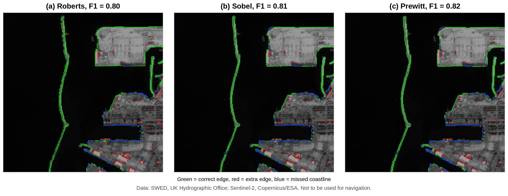
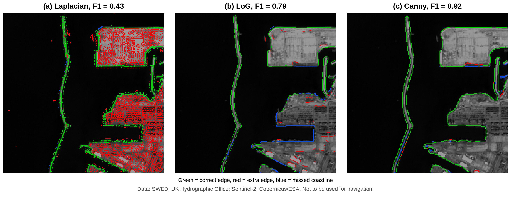
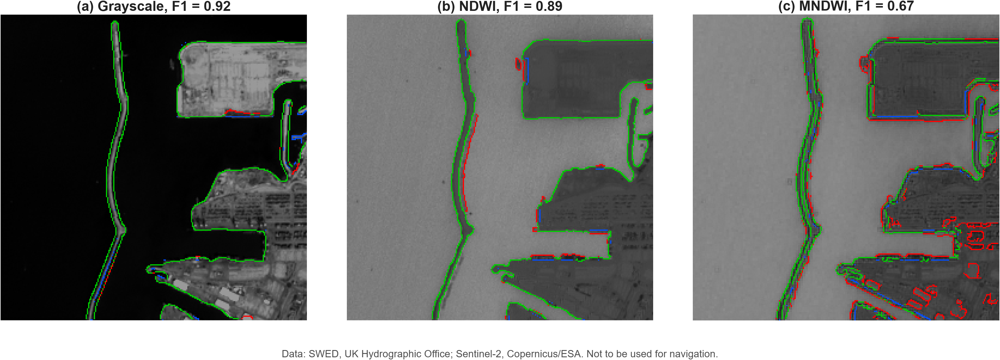

# Classroom Filter Comparison

> Track B deliverable (Shivakshi & Rajendra). Theory and results are taken from the Group 15 term paper (Sections 2.2, 3.2–3.4, 4.3–4.5). All scores are from the Ashdod port scene of the SWED dataset.

---

## 1. How an edge filter works

An edge filter slides a small grid of numbers (a **kernel**) over the image, multiplies each kernel value by the pixel below it and adds the results. Edge kernels are **zero-sum**: their values add up to zero.

- On a flat area (all pixels equal), the answer is **0**, so there is no edge.
- Across an edge (e.g. water = 20 on the left, land = 100 on the right), the Sobel *Gx* kernel gives (−1 −2 −1)×20 + (1 + 2 + 1)×100 = **320**, a large response.

In calculus terms, these filters measure the **first derivative** of brightness. Edges lie where it is large. Using two kernels (horizontal *Gx* and vertical *Gy*) gives:

$$G = \sqrt{G_x^2 + G_y^2} \qquad \theta = \tan^{-1}\!\left(\frac{G_y}{G_x}\right)$$

where *G* is the edge strength and *θ* the direction of the change.

---

## 2. The classroom filters

| Filter | Year | Kernel size | Main idea | Main problem |
| :--- | :---: | :---: | :--- | :--- |
| **Roberts** | 1963 | 2 × 2 | Very small diagonal differences | Easily disturbed by noise |
| **Sobel** | 1968 | 3 × 3 | Extra weight on the centre row/column | Thick edges |
| **Prewitt** | 1970 | 3 × 3 | Equal weights | Noise and thick edges |
| **Laplacian** | – | 3 × 3 | Second derivative, all directions at once (zero crossings) | Very sensitive to noise |
| **LoG** (Marr–Hildreth) | 1980 | variable | Gaussian blur first, then Laplacian | Less noise, but corners get rounded |
| **Canny** | 1986 | variable | Derived from 3 goals: good detection, good localisation, one response per edge | Also marks docks and buildings |

### Kernels

**Roberts cross**

$$G_x = \begin{bmatrix} -1 & 0 \\ 0 & 1 \end{bmatrix} \qquad G_y = \begin{bmatrix} 0 & -1 \\ 1 & 0 \end{bmatrix}$$

**Prewitt**

$$G_x = \begin{bmatrix} -1 & 0 & 1 \\ -1 & 0 & 1 \\ -1 & 0 & 1 \end{bmatrix} \qquad G_y = \begin{bmatrix} -1 & -1 & -1 \\ 0 & 0 & 0 \\ 1 & 1 & 1 \end{bmatrix}$$

**Sobel**

$$G_x = \begin{bmatrix} -1 & 0 & 1 \\ -2 & 0 & 2 \\ -1 & 0 & 1 \end{bmatrix} \qquad G_y = \begin{bmatrix} -1 & -2 & -1 \\ 0 & 0 & 0 \\ 1 & 2 & 1 \end{bmatrix}$$

**Laplacian**

$$\nabla^2 = \begin{bmatrix} 0 & 1 & 0 \\ 1 & -4 & 1 \\ 0 & 1 & 0 \end{bmatrix}$$

**Laplacian of Gaussian (LoG)**: the image is first smoothed with a Gaussian of width *σ*, then the Laplacian is applied, and edges are taken at the zero crossings.

**Canny** works in five steps:
1. Gaussian blur (*σ*)
2. Sobel gradient (strength *G* and direction *θ*)
3. Non-maximum suppression (thins edges to 1 pixel, using 4 direction sectors)
4. Double threshold (strong / weak pixels; low = 0.4 × high)
5. Hysteresis (keep weak pixels only if they are connected to strong ones)

**Common limitation of the pre-Canny filters:** they only *highlight* edges. They do not decide where the edge really is, their lines are thick and noisy, and a line that fades in one place breaks into pieces.

---

## 3. Experimental setup

- **Data:** Sentinel-2 scene of Ashdod port (Israel) from the SWED dataset (UK Hydrographic Office). The hand-drawn water mask serves as ground truth.
- **Inputs:** Grayscale, NDWI, MNDWI
- **Tool:** MATLAB Online (`edge` function, Image Processing Toolbox)
- **Settings search (best F1 kept per filter and input):**
  - Roberts / Sobel / Prewitt / Laplacian: 9 thresholds (0.25× to 3× MATLAB's automatic value)
  - LoG: *σ* ∈ {1, 1.5, 2, 3} × 9 thresholds
  - Canny: *σ* ∈ {1, 1.5, 2, 3, 4} × 14 high thresholds (0.05–0.70) = 70 runs per input
- **Ground-truth coastline:** every water pixel with at least one land pixel among its 8 neighbours (1,730 pixels)
- **Tolerance:** 2 pixels (20 m)
- **Metrics:**

$$\text{Precision} = \frac{\text{correct}}{\text{correct} + \text{extra}} \qquad \text{Recall} = \frac{\text{coastline found}}{\text{whole coastline}} \qquad F_1 = \frac{2PR}{P + R}$$

---

## 4. Results

### Table A. Six filters on the Grayscale input (best setting each)

| Filter | Best setting | Precision | Recall | F1 |
| :--- | :--- | :---: | :---: | :---: |
| Roberts | threshold 0.199 | 0.78 | 0.83 | 0.80 |
| Sobel | threshold 0.215 | 0.83 | 0.80 | 0.81 |
| Prewitt | threshold 0.211 | 0.83 | 0.80 | 0.82 |
| Laplacian | threshold 0.133 | 0.28 | 0.98 | 0.43 |
| LoG | σ = 3, threshold 0.0054 | 0.79 | 0.79 | 0.79 |
| **Canny** | **σ = 3, high threshold 0.50** | **0.94** | **0.91** | **0.92** |

*Figure 27. Roberts, Sobel and Prewitt on the Grayscale input. Green = correct edge, red = extra edge, blue = missed coastline.*

*Figure 28. Laplacian, LoG and Canny on the Grayscale input.*

### Table B. F1 score by input image

| Filter | Grayscale | NDWI | MNDWI |
| :--- | :---: | :---: | :---: |
| Roberts | 0.80 | 0.82 | 0.78 |
| Sobel | 0.81 | 0.85 | 0.74 |
| Prewitt | 0.82 | 0.85 | 0.73 |
| Laplacian | 0.43 | 0.28 | 0.56 |
| LoG | 0.79 | 0.76 | 0.62 |
| **Canny** | **0.92** | **0.89** | 0.67 |

*Figure 29. Canny on the three inputs, each with its best setting: (a) Grayscale, (b) NDWI, (c) MNDWI.*

*Data for all figures: SWED, UK Hydrographic Office; Sentinel-2, Copernicus/ESA. Not to be used for navigation.*

---

## 5. Key observations

- **Canny was the best filter overall** (F1 0.92), highest in both precision and recall. Thinning kept edges one pixel wide, and hysteresis kept long weak parts of the shore whole.
- **Roberts, Sobel, Prewitt** (F1 0.80–0.82) found most of the coastline, but their lines were broken along the docks, and they marked extra pieces on buildings.
- **Laplacian** (F1 0.43) found almost the whole coastline (recall 0.98) but also marked nearly every building (precision 0.28). This is the expected noise sensitivity of an unblurred second-derivative filter.
- **LoG** (F1 0.79) removed most of the clutter but missed long parts of the dock edges.
- **Input choice matters:** NDWI helped the simple filters (Sobel and Prewitt 0.81 → 0.85), because it makes water uniformly bright and land dark. For Canny, Grayscale was slightly better (0.92 vs 0.89) at Ashdod, where the sea is clear and contrast is already strong.
- **MNDWI was weakest for most filters.** Its 20 m SWIR band makes the shore blocky. Only the Laplacian improved on it.

## 6. Limitations

- Only **one scene** (Ashdod, clear water) was tested, and settings were chosen and scored on that same scene, so scores may be optimistic.
- Canny also detects docks and buildings, so its output needs cleaning (e.g. keeping only large connected land/water regions, as in Liu & Jezek, 2004).
- Turbid water, wet sand or vegetated coasts may favour a different filter or input. This is the planned 4-terrain extension (see AGENTS.md, Track B).

---

## References

- Canny, J. (1986). A computational approach to edge detection. *IEEE TPAMI*, 8(6), 679–698.
- Gonzalez, R. C., & Woods, R. E. (2018). *Digital Image Processing* (4th ed.). Pearson.
- Marr, D., & Hildreth, E. (1980). Theory of edge detection. *Proc. R. Soc. Lond. B*, 207, 187–217.
- Liu, H., & Jezek, K. C. (2004). Automated extraction of coastline from satellite imagery by integrating Canny edge detection and locally adaptive thresholding methods. *Int. J. Remote Sensing*, 25(5), 937–958.
- Seale, C., Redfern, T., Chatfield, P., Luo, C., & Dempsey, K. (2022). Coastline detection in satellite imagery: A deep learning approach on new benchmark data. *Remote Sensing of Environment*, 278, 113044. (SWED dataset, UK Hydrographic Office)
